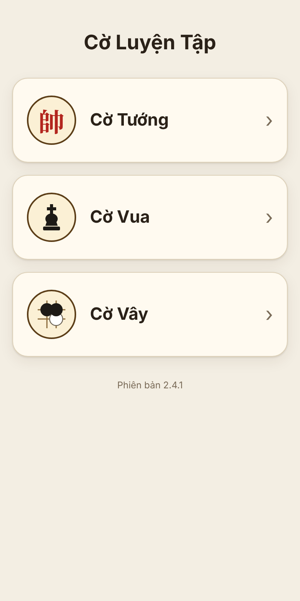
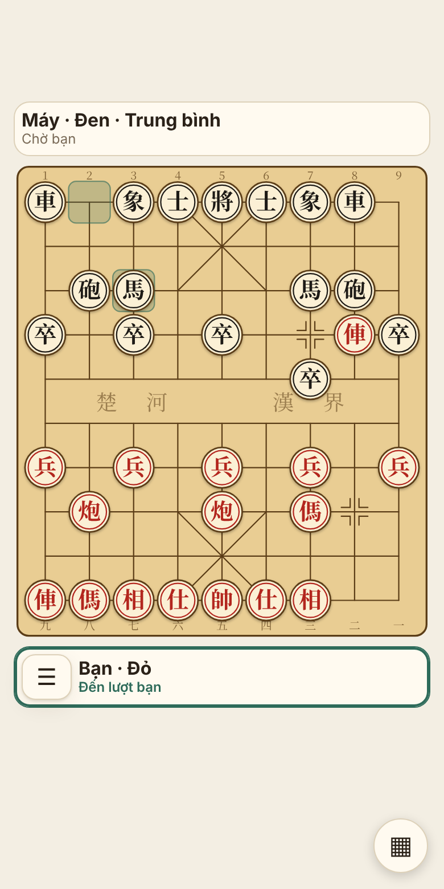
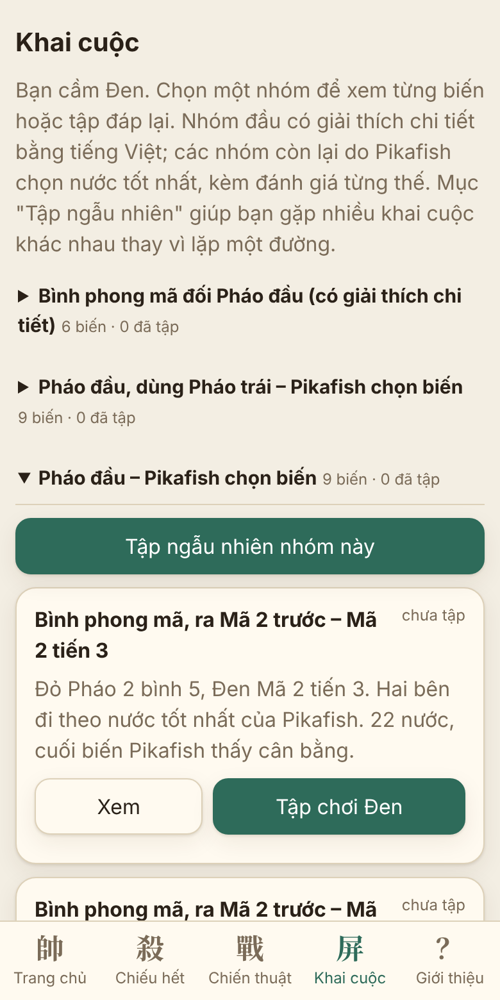
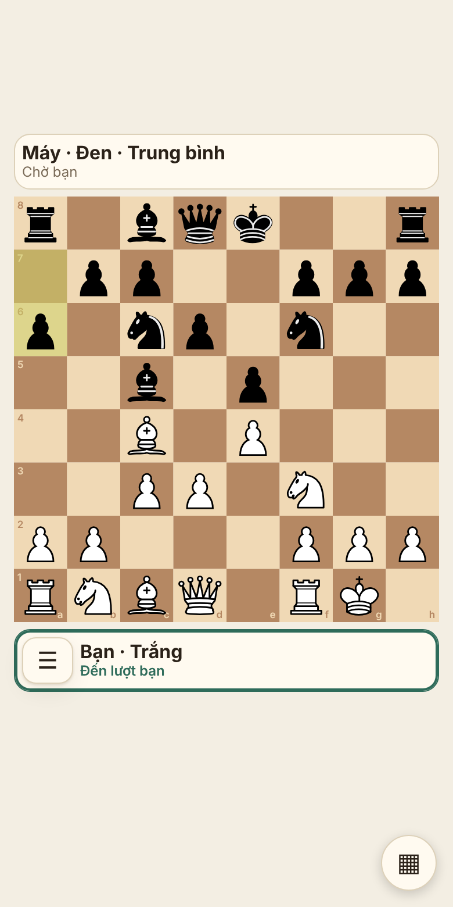
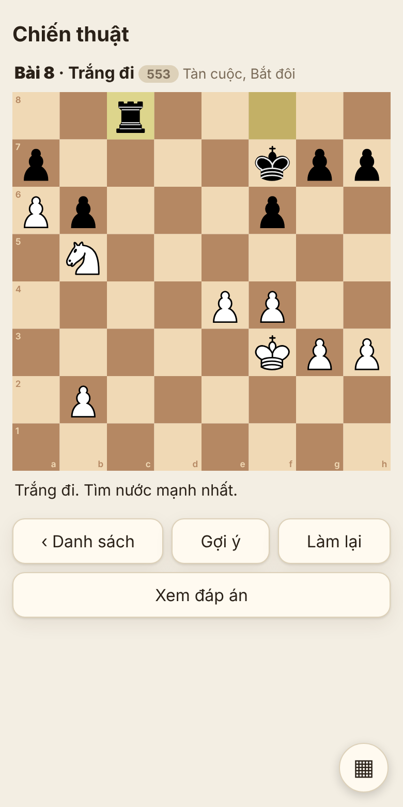
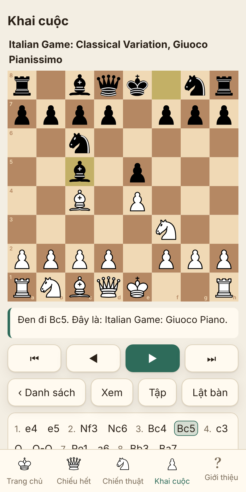
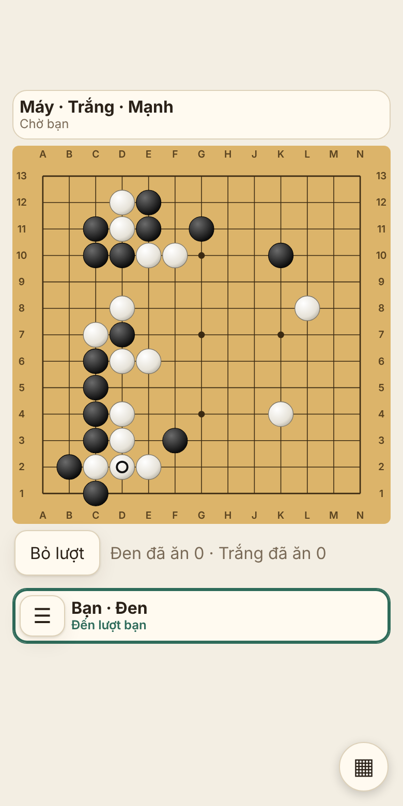
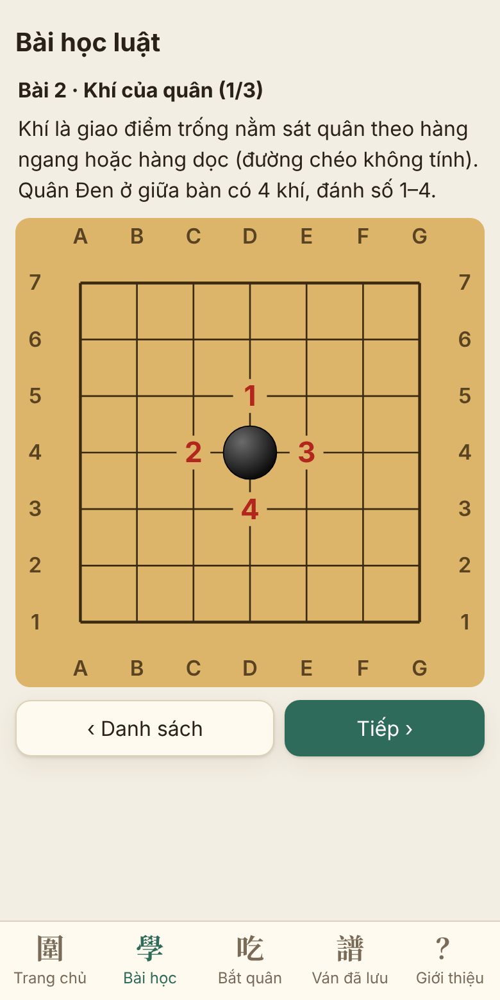
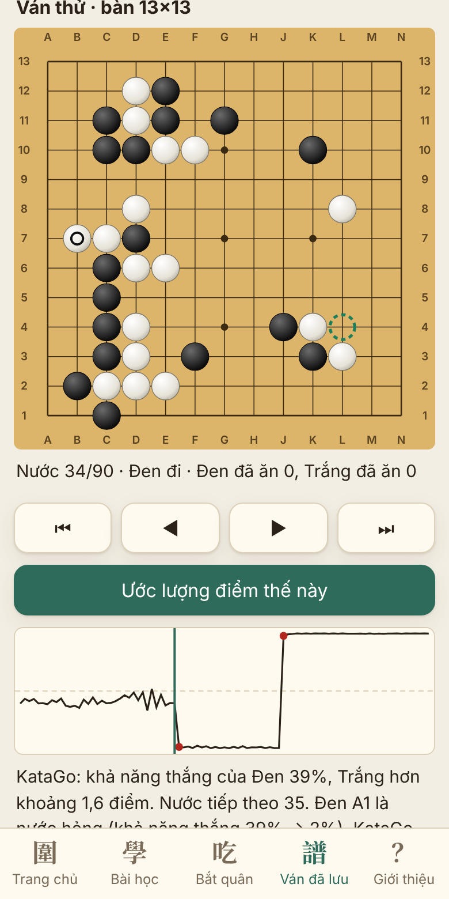

# Cờ Luyện Tập: Cờ Tướng, Cờ Vua và Cờ Vây

Web app luyện cờ miễn phí bằng tiếng Việt. Chạy ngay trên trình duyệt, cài được lên màn hình chính điện thoại như một ứng dụng,
dùng được khi không có mạng, không cần tài khoản và không thu thập dữ liệu.

**Mở app: <https://mercyk24.github.io/co-luyen-tap/>**

<p align="center"></p>

## Có gì trong app

Ba loại cờ dùng chung một khung:

- **Đấu máy 6 cấp**, từ người mới tới cao thủ. Máy mạnh chạy ngay trên máy của bạn: Fairy-Stockfish cho cờ tướng và cờ vua, KataGo cho cờ vây.
- **Hai người một máy**: đặt điện thoại giữa bàn, hai người ngồi đối mặt, có đồng hồ.
- **Chơi qua mạng** bằng mã phòng hoặc link mời, không cần tài khoản; người khác vào **xem trận** được; tự nối lại khi rớt mạng.
- **Bài tập** riêng cho từng loại cờ, **ván đã lưu** để xem lại và phân tích từng nước.
- Giao diện gọn cho điện thoại: khi đang đánh, các nút gom vào menu ☰; cờ vây bàn lớn **bấm hai lần để đặt quân** (tránh bấm nhầm).
- **Sao lưu / khôi phục** toàn bộ dữ liệu ra một tệp. **Báo lỗi tự nguyện**: bạn xem trước rồi tự gửi, app không tự gửi gì đi.

Mỗi loại cờ có luật, tiến độ, ván đã lưu, cài đặt và phòng chơi qua mạng riêng, không lẫn sang nhau.

## Cờ Tướng

| Đấu máy | Phân tích ván | Khai cuộc | Chiến thuật |
|:---:|:---:|:---:|:---:|
|  |  |  |  |

- **Đấu máy 6 cấp**: cấp 1–5 dùng engine tự viết; cấp 6 (Cao thủ) dùng Fairy-Stockfish với mạng NNUE cờ tướng. Máy mở đầu theo sách khai cuộc do Pikafish sinh nên mỗi ván một khác.
- **Phân tích ván**: engine duyệt lại từng nước, đánh dấu nước chưa chính xác / sai lầm / sai lầm nặng, chỉ nước đúng và đường đi dự kiến, có biểu đồ thế cờ. Ba mức: Nhanh, Kỹ, Rất kỹ.
- **Lỗi của bạn**: những thế bạn đi sai nặng tự thành bài tập; đúng 2 lần liên tiếp thì coi là đã thuộc.
- **Chiến thuật** theo hạng (700–1400+), chế độ 3 phút, 5 phút và sinh tồn; **chiếu hết** liên tục có lời giải kiểm chứng.
- **Khai cuộc** (người học cầm Đen): Bình phong mã đối Pháo đầu có giải thích chi tiết, cùng 63 biến do Pikafish chọn cho 7 cách mở đầu phổ biến của Đỏ.
- **Luật chiếu dai, đuổi dai**; ghi nước bằng tiếng Việt (Mã 8 tiến 7), đổi được sang chữ Hán.
- Hai người một máy: quân Đen quay về phía người cầm Đen, mỗi người một menu ở phía mình để xin hòa, xin đi lại, chịu thua.

## Cờ Vua

| Đấu máy | Chiến thuật | Khai cuộc |
|:---:|:---:|:---:|
|  |  |  |

- **Luật đầy đủ**: nhập thành, bắt tốt qua đường, phong cấp, chiếu hết, hết nước đi, hòa khi lặp lại ba lần, luật 50 nước, không đủ quân. Lõi luật được kiểm bằng perft.
- **Đấu máy 6 cấp**: cấp 1–5 engine tự viết, cấp 6 Fairy-Stockfish; máy mở đầu theo sách khai cuộc phổ biến.
- **Chiếu hết (1–5 nước) và chiến thuật** từ kho bài tập công khai của Lichess, lọc bài được chơi nhiều và đánh giá cao.
- **Khai cuộc**: 13 nhóm (Ván cờ Ý, Tây Ban Nha, Gambit Hậu, London, Sicilia, Pháp, Caro-Kann…), giới thiệu ý tưởng bằng tiếng Việt, chế độ xem và tập.
- **Phân tích ván** và **Lỗi của bạn** như cờ tướng. Ghi nước theo ký hiệu quốc tế (e4, Nf3, O-O).

## Cờ Vây

| Đấu máy (KataGo) | Bài học luật | Phân tích cả ván |
|:---:|:---:|:---:|
|  |  |  |

- **Bàn 9×9, 13×13, 19×19**, luật Trung Quốc (đếm quân sống và đất, Trắng được 7,5 điểm bù). Có kiểu **cờ bắt quân** (ai ăn quân trước là thắng) cho người mới.
- **Đấu máy 6 cấp**: cấp 1–2 máy Monte-Carlo tự viết, không cần tải; cấp 3–6 **KataGo** (mạng nơ-ron chạy ngay trong trình duyệt, tải khoảng 7 MB lần đầu), từ mức khá tới cao thủ nghiệp dư.
- **Gợi ý nước, đếm điểm** (máy đánh dấu sẵn quân chết, bạn sửa được) và **ước lượng điểm** ở thế bất kỳ, dùng KataGo.
- **Phân tích cả ván**: biểu đồ khả năng thắng theo từng nước, đánh dấu nước dở `?` / nước hỏng `??` kèm nước KataGo đề nghị.
- **10 bài học luật** có bàn cờ tương tác (khí, ăn quân, kiếp, hai mắt, thang, lưới, đếm điểm) và **260 bài bắt quân** 1–5 nước.
- Xuất / nhập ván **SGF**, định dạng chung của mọi phần mềm cờ vây.

## Cài lên điện thoại

Mở link ở trên bằng Safari (iPhone) hoặc Chrome (Android), chọn loại cờ, rồi bấm **Chia sẻ → Thêm vào Màn hình chính**
(Android: menu ⋮ → **Cài đặt ứng dụng** / **Thêm vào màn hình chính**). Mỗi loại cờ cài thành một biểu tượng riêng.

- Lần đầu dùng máy mạnh, app tải thêm engine rồi lưu lại để chạy ngoại tuyến: cờ tướng khoảng 13 MB, cờ vua khoảng 2 MB
  (cấp 6 hoặc phân tích ván), cờ vây khoảng 7 MB (cấp 3–6, gợi ý, đếm điểm, phân tích).
- Cần trình duyệt bản mới: Safari iOS 16 trở lên, Chrome, Edge, Firefox. Fairy-Stockfish dùng khoảng 460 MB bộ nhớ; máy không đủ
  thì app tự chuyển về cấp 5. KataGo chạy được cả trên máy cũ như iPhone 8.

## Phát triển

Cần Node.js 22 trở lên.

```bash
npm ci                           # cài công cụ kiểm tra (ESLint, Playwright)
npx playwright install chromium  # một lần, để chạy kiểm tra giao diện
npm start                        # dựng dist/ và chạy tại http://localhost:4173
npm test                         # kiểm tra lỗi mã + luật cờ + dữ liệu + giao diện
```

| Lệnh | Việc làm |
|---|---|
| `npm run build` | Dựng `dist/`: trang chủ và `co-tuong/`, `co-vua/`, `co-vay/` (mỗi trang một tệp nhúng sẵn dữ liệu), service worker, engine. |
| `npm run lint` | Kiểm tra lỗi mã bằng ESLint. |
| `npm run test:unit` | Luật cờ (perft, ký hiệu, FEN, đếm điểm, SGF), KataGo so với bản gốc, toàn vẹn dữ liệu trong `data/`. |
| `npm run test:e2e` | Kiểm tra giao diện bằng Playwright, kể cả engine mạnh, KataGo và chơi qua mạng. |
| `node scripts/screenshots.js` | Chụp lại các ảnh trong `docs/screenshots/` (chạy `npm run build` trước). |
| `npm run openings` | Dựng lại khai cuộc cờ tướng `data/xiangqi/openings.json`, `book.json`. |
| `node tools/chess/fetch-data.mjs`, `node tools/chess/build-data.js` | Tải nguyên liệu và dựng dữ liệu cờ vua `data/chess/*.json`. |
| `node tools/go/gen_puzzles.js` | Sinh lại bài bắt quân cờ vây `data/go/puzzles.json`. |
| `node tools/go/kata_convert.js <mạng.bin.gz> <ra.kgo>` | Đổi mạng KataGo sang tệp `.kgo` của app. |
| `npm run signal` | Chạy điểm hẹn chơi qua mạng trên máy (`ws://localhost:4174`). |
| `XQ_NET_REAL=1 npx playwright test net-real` | Thử chơi qua mạng với điểm hẹn thật (cần Internet, không chạy trên CI). |

Mỗi loại cờ có thư mục riêng: `xiangqi/` cờ tướng, `chess/` cờ vua, `go/` cờ vây, `shared/` dùng chung; dòng đầu mỗi tệp ghi nhãn
**[DÙNG CHUNG]**, **[CỜ TƯỚNG]**, **[CỜ VUA]** hoặc **[CỜ VÂY]**. Sơ đồ đầy đủ và bảng "muốn sửa X thì sửa ở đâu":
**[docs/CAU-TRUC.md](docs/CAU-TRUC.md)**. Nguồn dữ liệu: [cờ tướng](docs/DU-LIEU-CO-TUONG.md), [cờ vua](docs/DU-LIEU-CO-VUA.md),
[cờ vây](docs/DU-LIEU-CO-VAY.md).

Quy ước: không sửa `dist/`, `.build/` (bản tự sinh); chữ hiển thị viết bằng tiếng Việt; phát hành bản mới thì tăng `version`
trong `package.json` và ghi `CHANGELOG.md` (service worker tự đổi bộ nhớ đệm theo phiên bản).

### Triển khai

Mỗi lần đẩy lên nhánh `main`, GitHub Actions (`.github/workflows/ci.yml`) chạy toàn bộ kiểm tra; đạt thì tự đăng `dist/` lên
GitHub Pages (nguồn Pages đặt là **GitHub Actions**). Điểm hẹn chơi qua mạng chạy trên Cloudflare Workers (`server/`,
`npx wrangler deploy`); cách cài, số đo tải và chi phí: [docs/MO-RONG.md](docs/MO-RONG.md).

### Chơi qua mạng

Hai máy nối thẳng bằng WebRTC; nước đi không qua máy chủ. Điểm hẹn để hai máy tìm thấy nhau: điểm hẹn riêng của dự án
(Cloudflare, mỗi phòng một ô riêng; khi mạng chặn nối thẳng thì ván đi qua đây), dự phòng là `0.peerjs.com`. Trước lần chơi
qua mạng đầu tiên, app xin người dùng đồng ý gửi thông tin kết nối (địa chỉ IP…) ra ngoài máy. Giới hạn còn lại: [docs/RA-SOAT.md](docs/RA-SOAT.md).

## Quyền riêng tư

App không có tài khoản, không quảng cáo, không đo lường; ván cờ, tiến độ và cài đặt chỉ lưu trên máy của bạn. Chính sách đầy đủ: trong app
(Giới thiệu › Quyền riêng tư) và [docs/CHINH-SACH-RIENG-TU.md](docs/CHINH-SACH-RIENG-TU.md). Lộ trình pháp lý trước khi thương mại hoá:
[docs/PHAP-LY.md](docs/PHAP-LY.md).

## Giấy phép và ghi công

Mã nguồn phát hành theo **GNU GPL phiên bản 3 hoặc mới hơn** (`LICENSE`), vì app phân phối kèm Fairy-Stockfish (GPL-3.0).

- [Fairy-Stockfish](https://github.com/fairy-stockfish/Fairy-Stockfish) và [fairy-stockfish.wasm](https://github.com/fairy-stockfish/fairy-stockfish.wasm) – GPL-3.0; mạng NNUE cờ tướng từ [danh sách mạng của Fairy-Stockfish](https://fairy-stockfish.github.io/nnue/).
- [Pikafish](https://github.com/official-pikafish/Pikafish) – GPL-3.0, chỉ dùng trên máy tính để sinh dữ liệu bài tập và khai cuộc cờ tướng, không phân phối kèm app.
- Cờ vua: hình quân [cburnett](https://github.com/lichess-org/lila/tree/master/public/piece/cburnett) (Colin M.L. Burnett, GPLv2+); [kho bài tập Lichess](https://database.lichess.org/#puzzles) và [danh mục khai cuộc](https://github.com/lichess-org/chess-openings) – CC0.
- Cờ vây: [KataGo](https://github.com/lightvector/KataGo) – phần mã viết lại theo giấy phép MIT, mạng g170 – CC0; [TensorFlow.js](https://github.com/tensorflow/tfjs) – Apache-2.0. Lõi luật, máy Monte-Carlo, bài học và bài bắt quân do dự án tự viết.
- Chi tiết engine: [engine/README.md](engine/README.md). Danh sách đầy đủ thành phần bên thứ ba: [NOTICE](NOTICE).
