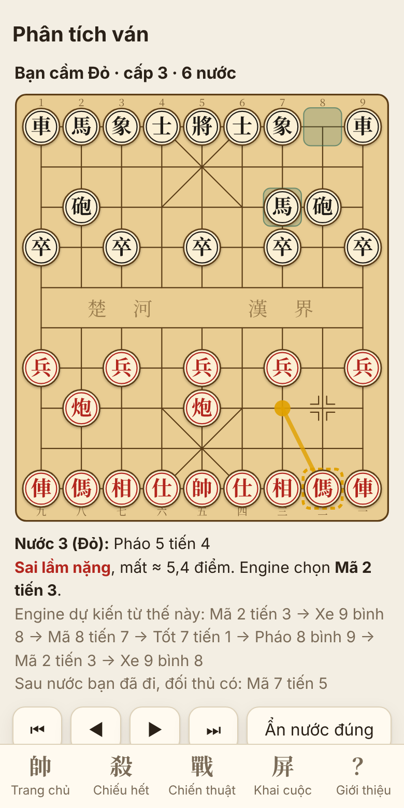
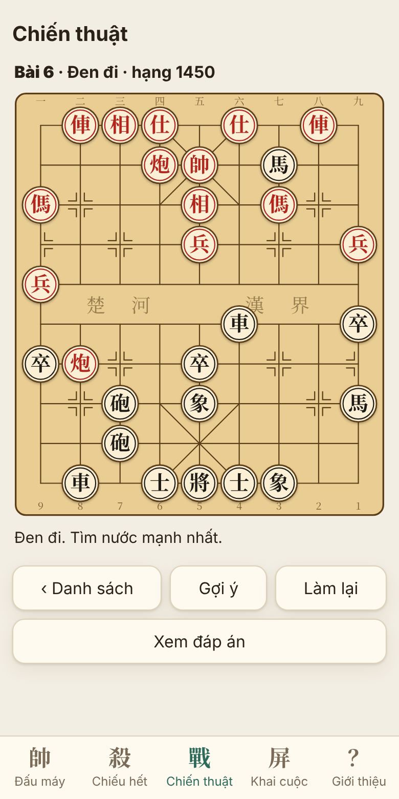

# Cờ Luyện Tập: Cờ Tướng và Cờ Vua

Web app luyện cờ miễn phí, chạy ngay trên trình duyệt (cài được lên màn hình chính iPhone như một ứng dụng), dùng được khi không có mạng, không cần tài khoản và không thu thập dữ liệu.

Trang chủ (`/`) cho chọn loại cờ:

- **Cờ Tướng** – `/co-tuong/` (link mời cũ dạng `…/#phong=ABC123` tự chuyển về đây).
- **Cờ Vua** – `/co-vua/`.

Hai app dùng chung khung (đấu máy 6 cấp, hai người một máy, chơi qua mạng, phân tích ván, chiếu hết, chiến thuật, khai cuộc, sao lưu), nhưng **luật, dữ liệu, tiến độ, cài đặt và phòng chơi qua mạng hoàn toàn tách riêng**: lõi luật riêng (`src/core/xq.js`, `src/core/chess.js`), khoá lưu trữ riêng (`xq_…`, `xc_…`), tệp sao lưu của loại cờ này không khôi phục được vào loại kia, mã phòng của cờ vua không vào được phòng cờ tướng.

## Cờ Vua

- **Luật đầy đủ**: nhập thành, bắt tốt qua đường, phong cấp (chọn Hậu, Xe, Tượng, Mã; có tuỳ chọn "Luôn phong Hậu"), chiếu hết, hết nước đi (pat), hòa khi lặp lại ba lần, luật 50 nước, không đủ quân để chiếu hết. Lõi luật được kiểm bằng perft trên 6 thế chuẩn.
- **Ghi nước theo ký hiệu quốc tế (SAN)**: e4, Nf3, O-O, exd6, e8=Q+.
- **Đấu máy 6 cấp**: cấp 1–5 dùng engine tự viết, cấp 6 dùng Fairy-Stockfish (biến thể chess). Máy mở đầu theo sách tổng hợp từ các khai cuộc phổ biến.
- **Hai người một máy, chơi qua mạng, phân tích ván và "Lỗi của bạn"** như bên cờ tướng.
- **Chiếu hết (1–5 nước) và chiến thuật** lấy từ kho bài tập công khai của Lichess (CC0), lọc bài được chơi nhiều và đánh giá cao; mọi lời giải được kiểm lại bằng lõi luật của app.
- **Khai cuộc**: 13 nhóm (Ván cờ Ý, Tây Ban Nha, Gambit Hậu, Hệ thống London, Khai cuộc Anh, Gambit Vua, Sicilia, Pháp, Caro-Kann, Scandinavia, Ấn Độ cổ, Slav, Nimzo-Ấn), giới thiệu ý tưởng bằng tiếng Việt, các biến chính do dự án chọn, tên biến theo danh mục khai cuộc của Lichess (CC0).
- **Hình quân** "cburnett" (Colin M.L. Burnett, GPLv2+).

## Cờ Tướng

| Đấu máy | Phân tích ván | Khai cuộc | Chiến thuật |
|---|---|---|---|
|  |  |  |  |

- **Giao diện gọn, tránh bấm nhầm**: khi đang đánh, các nút được gom vào menu ☰ và thanh điều hướng thu thành một nút tròn.
- **Đấu máy** 6 cấp. Cấp 1–5 dùng engine tự viết; cấp 6 (Cao thủ) dùng Fairy-Stockfish với mạng NNUE cờ tướng chạy bằng WebAssembly ngay trong trình duyệt. Máy mở đầu theo sách khai cuộc do Pikafish sinh, nên mỗi ván đổi hướng ở 5–6 nước đầu.
- **Hai người chơi trên một máy**: đặt máy nằm giữa cho hai người ngồi đối mặt (quân Đen quay về phía Đen), chọn thời gian trước khi vào ván, mỗi người một menu ở phía mình để xin hòa, xin đi lại, chịu thua; ván xong phân tích được cho cả hai bên.
- **Chơi qua mạng**: tạo phòng bằng mã 6 ký tự hoặc link mời, hai máy nối thẳng (WebRTC) không cần tài khoản; tự nối lại khi rớt mạng.
- **Phân tích ván**: engine mạnh duyệt lại từng nước, đánh dấu nước chưa chính xác / sai lầm / sai lầm nặng, chỉ nước đúng và đường đi dự kiến, có biểu đồ thế cờ và nút soi sâu một thế. Ba mức: Nhanh, Kỹ, Rất kỹ.
- **Lỗi của bạn**: những thế bạn đi sai nặng tự thành bài tập riêng; đúng ngay 2 lần liên tiếp thì coi là đã thuộc.
- **Chiến thuật**: bài tìm nước mạnh nhất theo hạng (700–1400+), chế độ 3 phút, 5 phút và sinh tồn, có lịch sử điểm.
- **Chiếu hết**: bài chiếu hết liên tục, lời giải được kiểm chứng bằng bộ giải.
- **Khai cuộc** (người học cầm Đen): Bình phong mã đối Pháo đầu có giải thích chi tiết, cùng 63 biến dài do Pikafish chọn cho 7 cách mở đầu phổ biến của Đỏ. Nước đáp tương đương với nước trong sách không bị tính là sai.
- **Luật chiếu dai, đuổi dai**: được chiếu (đuổi) liên tục tối đa 4 nước làm thế cờ lặp lại; nước thứ 5 không được đi, phải đổi nước.
- **Ghi nước bằng tiếng Việt** (Mã 8 tiến 7), đổi được sang chữ Hán hoặc hiện cả hai.
- **Sao lưu / khôi phục** toàn bộ dữ liệu ra một file JSON (mục Giới thiệu).
- **Báo lỗi tự nguyện**: xem trước rồi tự chép thông tin lỗi gửi người phát triển; app không tự gửi gì đi.

## Dùng thử

Mở trang GitHub Pages của dự án bằng Safari, chọn loại cờ, bấm **Chia sẻ → Thêm vào Màn hình chính** (mỗi loại cờ cài thành một biểu tượng riêng). Lần đầu dùng cấp 6 hoặc phân tích ván, app tải thêm khoảng 13 MB engine; sau đó mọi thứ chạy ngoại tuyến.

Yêu cầu: trình duyệt hỗ trợ WebAssembly và SharedArrayBuffer (Safari iOS 16+, Chrome, Edge, Firefox bản mới). Engine dùng khoảng 460 MB bộ nhớ; nếu máy không đủ, app tự chuyển về cấp 5.

## Phát triển

Cần Node.js 20 trở lên.

```bash
npm ci                         # cài công cụ kiểm tra (ESLint, Playwright)
npx playwright install chromium  # chỉ cần một lần, để chạy kiểm tra giao diện
npm start                      # dựng dist/ và chạy tại http://localhost:4173
npm test                       # kiểm tra lỗi mã + luật cờ + dữ liệu + giao diện
```

Các lệnh khác:

| Lệnh | Việc làm |
|---|---|
| `npm run build` | Dựng `dist/`: trang chủ `index.html`, `co-tuong/index.html`, `co-vua/index.html` (mỗi trang một file nhúng sẵn dữ liệu), kèm service worker và engine dùng chung. |
| `node tools/chess/fetch-data.mjs` | Tải nguyên liệu cờ vua (hình quân, danh mục khai cuộc, kho bài tập Lichess). Cần mạng, chạy một lần. |
| `node tools/chess/build-data.js` | Dựng `data/chess/*.json` từ nguyên liệu trên, kiểm lại mọi nước bằng lõi luật (không cần mạng). |
| `npm run lint` | Kiểm tra lỗi mã bằng ESLint. |
| `npm run test:unit` | Kiểm tra luật cờ tướng và cờ vua (perft, ký hiệu, FEN) và toàn vẹn dữ liệu trong `data/`, `data/chess/`. |
| `npm run test:e2e` | Kiểm tra giao diện bằng Playwright, kể cả engine mạnh và phân tích ván. |
| `npm run openings` | Dựng lại `data/openings.json` và `data/book.json` từ dữ liệu khai cuộc. |
| `node scripts/screenshots.js` | Chụp lại ảnh màn hình trong `docs/screenshots/`. |
| `XQ_NET_REAL=1 npx playwright test net-real` | Thử chơi qua mạng với điểm hẹn thật (cần Internet, không chạy trên CI). |
| `npm run signal` | Chạy điểm hẹn riêng trên máy (`ws://localhost:4174`), không cần cài gì. |
| `npm run load -- [địa chỉ] --cap 2500` | Thử tải điểm hẹn riêng: 2500 cặp = 5000 người cùng lúc. |

### Cấu trúc thư mục

```
src/
  core/xq.js            Lõi luật cờ tướng: sinh nước, ký hiệu Hán, FEN, engine alpha-beta, bộ giải chiếu hết (chạy được cả trong Node)
  core/chess.js         Lõi luật cờ vua: bàn 0x88, sinh nước, SAN, FEN, trạng thái kết thúc, engine alpha-beta, perft
  shared/*.js           Phần dùng chung hai app (tiện ích, lưu trữ, engine mạnh, chơi qua mạng, cài đặt, sao lưu, báo lỗi);
                        đọc cấu hình GAME (khoá lưu trữ, tiền tố mạng, tên app) của từng app
  app/*.js              Giao diện cờ tướng (00-game.js là cấu hình GAME), index.template.html là khung trang cờ tướng
  chess/app/*.js        Giao diện cờ vua, chess/index.template.html là khung trang cờ vua, chess/pieces/ là hình quân
  portal/index.html     Trang chủ chọn loại cờ
  assets/               Icon, service worker dùng chung (lưu ngoại tuyến cả ba trang + thêm tiêu đề COOP/COEP cho engine)
data/                   Dữ liệu cờ tướng (JSON) và dữ liệu thô sinh từ Pikafish
data/chess/             Dữ liệu cờ vua (JSON) và nguyên liệu tải về trong data/chess/src/
engine/                 Fairy-Stockfish WebAssembly và mạng NNUE cờ tướng (xem engine/README.md; mã băm trong engine/SHA256SUMS)
tools/                  Công cụ sinh dữ liệu cờ tướng bằng Pikafish (docs/data.md); tools/chess/ cho cờ vua; thử điểm hẹn
server/                 Điểm hẹn riêng cho chơi qua mạng: core.mjs (lõi), worker.mjs (Cloudflare), dev-server.mjs (Node)
scripts/                build.js, serve.js, screenshots.js
tests/unit/             Kiểm tra bằng node:test
tests/e2e/              Kiểm tra giao diện bằng Playwright
```

### Quy ước

- Không sửa `dist/` hay `.build/`: đó là bản tự sinh.
- Chữ hiển thị cho người dùng viết bằng tiếng Việt; ký hiệu nước đi lưu nội bộ bằng chữ Hán và được chuyển sang tiếng Việt khi hiển thị.
- Khi phát hành bản mới: tăng `version` trong `package.json` và ghi vào `CHANGELOG.md`. Tên cache của service worker tự đổi theo phiên bản và nội dung, nên người dùng luôn nhận bản mới.

## Triển khai

Mỗi lần đẩy lên nhánh `main`, GitHub Actions (`.github/workflows/ci.yml`) chạy toàn bộ kiểm tra; nếu đạt thì tự đăng `dist/` lên GitHub Pages. Pull request chỉ chạy kiểm tra. Trong phần cài đặt Pages của kho, nguồn (Source) phải đặt là **GitHub Actions**.

## Chơi qua mạng

`src/shared/45-net.js`: hai máy nối thẳng bằng WebRTC. Để tìm thấy nhau, app dùng điểm hẹn nói giao thức PeerJS (phần kết nối tự viết) và STUN của Google, Cloudflare; nước đi không qua máy chủ.

- **Điểm hẹn riêng** (`server/`, chạy trên Cloudflare Workers + Durable Objects, mỗi phòng một ô riêng): dùng trước nếu đã điền `NET_OWN` trong `45-net.js`. Mã máy cờ tướng bắt đầu bằng `xqvn-`, cờ vua bằng `xcvn-`; điểm hẹn giữ phòng của hai loại cờ tách riêng. Khi mạng chặn nối thẳng, ván tự đi qua điểm hẹn này.
- **Điểm hẹn công cộng** `0.peerjs.com`: dự phòng khi điểm hẹn riêng hỏng hoặc chưa cài.

Đã thử tải 5000 và 10 000 người cùng lúc. Cách đưa lên Cloudflare, số đo và chi phí: `docs/MO-RONG.md`. Giới hạn còn lại: `docs/RA-SOAT.md`.

Trước lần chơi qua mạng đầu tiên, app xin người dùng đồng ý gửi thông tin kết nối (địa chỉ IP…) ra ngoài máy.

## Quyền riêng tư và pháp lý

- Chính sách quyền riêng tư: trong app (Giới thiệu › Quyền riêng tư) và `docs/CHINH-SACH-RIENG-TU.md`.
- Lộ trình trước khi thương mại hoá (giấy phép trò chơi, dữ liệu cá nhân, chuyển dữ liệu ra nước ngoài): `docs/PHAP-LY.md`.
- Trang dùng chính sách nội dung (CSP) chặt, tính tự động khi dựng (`scripts/build.js`). Thêm mã nhúng hay địa chỉ kết nối mới thì sửa ở đó.

## Giấy phép và ghi công

Mã nguồn phát hành theo **GNU GPL phiên bản 3 hoặc mới hơn** (xem `LICENSE`), vì app phân phối kèm engine Fairy-Stockfish theo GPL-3.0.

- [Fairy-Stockfish](https://github.com/fairy-stockfish/Fairy-Stockfish) và bản WebAssembly [fairy-stockfish-nnue.wasm](https://github.com/fairy-stockfish/fairy-stockfish.wasm) – GPL-3.0. Mạng NNUE cờ tướng lấy từ [danh sách mạng NNUE của Fairy-Stockfish](https://fairy-stockfish.github.io/nnue/). Chi tiết và chỉnh sửa: `engine/README.md`.
- [Pikafish](https://github.com/official-pikafish/Pikafish) – GPL-3.0. Chỉ dùng trên máy tính để sinh dữ liệu bài tập và khai cuộc; không phân phối kèm app.
- Chuỗi nước của nhóm khai cuộc Bình phong mã lấy từ lý thuyết khai cuộc công khai; phần giải thích tiếng Việt do dự án viết.
- Cờ vua: hình quân [cburnett](https://github.com/lichess-org/lila/tree/master/public/piece/cburnett) của Colin M.L. Burnett – GPLv2 hoặc mới hơn; [kho bài tập Lichess](https://database.lichess.org/#puzzles) và [danh mục khai cuộc lichess-org/chess-openings](https://github.com/lichess-org/chess-openings) – CC0.
- Danh sách đầy đủ thành phần bên thứ ba: `NOTICE`.
